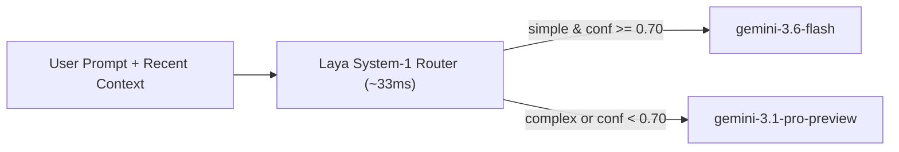

# Laya ADK Model Router (`laya_adk_model_router`)

Dynamic LLM model routing for [Google Agent Development Kit (ADK)](https://google.github.io/adk-docs/) powered by **[Laya (`convaiinnovations/laya`)](https://huggingface.co/convaiinnovations/laya)** — a fast (~33ms), non-autoregressive System-1 decision model.

Instead of sending every prompt to a heavy reasoning model or paying the latency of an LLM router call, `laya_adk_model_router` evaluates incoming user prompts in a single forward pass and dynamically routes ADK's `LlmRequest.model` between **`gemini-3.6-flash`** and **`gemini-3.1-pro-preview`**.

---

## Directory Structure

```text
model_router/
├── .gitignore
├── README.md
├── requirements.txt
└── laya_adk_model_router/
    ├── __init__.py
    ├── .env
    └── agent.py
```

---

## How It Works



1. **Intercept (`before_model_callback`)**: When a new user message arrives, [`LayaModelRouterPlugin`](laya_adk_model_router/agent.py) (or the standalone [`laya_router`](laya_adk_model_router/agent.py) callback) extracts `user_message` and up to 4 turns of `recent_context`.
2. **System-1 Classification**: [`laya.Router`](https://huggingface.co/convaiinnovations/laya) evaluates `LAYA_COMPLEXITY_QUESTIONS` in a single forward pass, returning a calibrated `choice` (`"simple"` or `"complex"`) and `answer_confidence`.
3. **Dynamic Model Swap**:
   - **`simple`** (with `answer_confidence >= 0.70`) $\rightarrow$ routes to **`gemini-3.6-flash`**.
   - **`complex`** (or low confidence `< 0.70`) $\rightarrow$ upgrades to **`gemini-3.1-pro-preview`**.
4. **Turn Persistence**: The selected model is saved in `callback_context.state["routed_model"]` so intermediate tool-response steps within the same turn stay on the routed model.

---

## Prerequisites & Installation

From the `model_router/` root directory:

```bash
uv venv
uv pip install -r requirements.txt
```

Configure your `.env` file inside `laya_adk_model_router/.env`:

```env
# Vertex AI via Google Cloud Application Default Credentials (ADC)
GOOGLE_GENAI_USE_VERTEXAI=TRUE
GOOGLE_CLOUD_PROJECT=your-gcp-project-id
GOOGLE_CLOUD_LOCATION=global
```

*(Alternatively, set `GOOGLE_API_KEY=...` with `GOOGLE_GENAI_USE_VERTEXAI=FALSE` to use the Gemini Developer API.)*

---

## Running the Agent

From the `model_router/` root directory:

```bash
# Launch the ADK Dev UI and select "laya_adk_model_router"
adk web

# Or run interactively in the terminal
adk run laya_adk_model_router
```

> **Note:** On the very first request, `laya` downloads the `convaiinnovations/laya` checkpoint (~846 MB) to your local Hugging Face cache (`~/.cache/huggingface/hub/`). All subsequent requests reuse the in-memory model.

---

## Usage Patterns

### 1. As an ADK App Plugin (Default)

```python
from google.adk.agents import Agent
from google.adk.apps import App
from laya_adk_model_router import LayaModelRouterPlugin

root_agent = Agent(
    name="root_agent",
    model="gemini-2.5-flash",
    instruction="You are an AI assistant.",
)

app = App(
    name="laya_adk_model_router",
    root_agent=root_agent,
    plugins=[LayaModelRouterPlugin(confidence_threshold=0.7)],
)
```

### 2. As a Standalone `before_model_callback`

```python
from google.adk.agents import Agent
from laya_adk_model_router import laya_router

root_agent = Agent(
    name="root_agent",
    model="gemini-2.5-flash",
    instruction="You are an AI assistant.",
    before_model_callback=laya_router,
)
```
