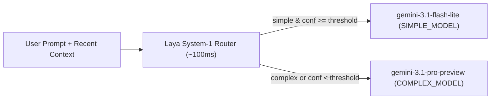

# Laya ADK Model Router (`laya_adk_model_router`)

Dynamic LLM model routing for [Google Agent Development Kit (ADK)](https://google.github.io/adk-docs/) powered by **[Laya (`convaiinnovations/laya`)](https://huggingface.co/convaiinnovations/laya)** — a fast (~33–100ms), non-autoregressive System-1 decision model.

Instead of sending every prompt to a heavy reasoning model or paying the latency and cost of an LLM router call, `laya_adk_model_router` evaluates incoming user prompts in a single forward pass and dynamically routes ADK's `LlmRequest.model` between **`gemini-3.1-flash-lite`** (`SIMPLE_MODEL`) and **`gemini-3.1-pro-preview`** (`COMPLEX_MODEL`).

---

## Directory Structure

```text
model_router/
├── .gitignore
├── README.md
├── requirements.txt
├── laya_adk_model_router/
│   ├── __init__.py
│   ├── .env
│   ├── agent.py
│   ├── plugin.py
│   └── questions.py
└── eval/
    ├── README.md
    ├── EVAL_REPORT.md
    ├── requirements-eval.txt
    ├── dataset_loader.py
    ├── multi_agent.py
    ├── run_eval.py
    └── data_cache/
        └── benchmark_samples_v2.json
```

---

## How It Works



1. **Intercept (`before_model_callback`)**: When a new user message arrives, [`LayaModelRouterPlugin`](laya_adk_model_router/plugin.py) (or the standalone [`laya_router`](laya_adk_model_router/plugin.py) callback) extracts `user_message` and up to 4 turns of `recent_context`.
2. **Role-Aware Agent Exclusions (`exclude_agents`)**: In multi-agent hierarchies, lightweight orchestrator/triage agents (e.g., `coordinator_agent`) can be listed in `exclude_agents={"coordinator_agent"}` so they remain pinned to `SIMPLE_MODEL` (`gemini-3.1-flash-lite`), while specialist sub-agents are dynamically routed by Laya.
3. **System-1 Classification & Latency Tracking**: [`laya.Router`](https://huggingface.co/convaiinnovations/laya) evaluates [`LAYA_COMPLEXITY_QUESTIONS`](laya_adk_model_router/questions.py) in a single forward pass (protected by an `asyncio.Lock` for safe concurrent execution), returning a calibrated `choice` (`"simple"` or `"complex"`), `answer_confidence`, and recording `laya_latency_ms` inside `callback_context.state["laya_routing"]`.
4. **Dynamic Model Swap**:
   - **`simple`** (with `answer_confidence >= confidence_threshold`) $\rightarrow$ routes to **`gemini-3.1-flash-lite`** (`SIMPLE_MODEL`).
   - **`complex`** (or low confidence `< confidence_threshold`) $\rightarrow$ upgrades to **`gemini-3.1-pro-preview`** (`COMPLEX_MODEL`).
5. **Turn Persistence**: The selected model is saved in `callback_context.state["routed_model"]` keyed by `invocation_id` so intermediate tool-response or sub-agent delegation steps within the same turn reuse the classification without redundant router calls.

> **Disclaimer — Customize [`LAYA_COMPLEXITY_QUESTIONS`](laya_adk_model_router/questions.py) for Your Use Case:**
> The default `simple` and `complex` criteria in [`laya_adk_model_router/questions.py`](laya_adk_model_router/questions.py) are general-purpose reasoning, math, coding, and IT examples. Because Laya conditions directly on your question `instructions` and `criteria` descriptions at inference time, **you should update `LAYA_COMPLEXITY_QUESTIONS` in `questions.py` (as well as `confidence_threshold`) to reflect the exact task boundaries, domain terminology, and escalation rules of your specific application or use case.**

---

## Laya Model Choice

The [`convaiinnovations/laya`](https://huggingface.co/convaiinnovations/laya) repository holds all three checkpoints and serves as the hub for the family. The English checkpoint is at the repo root; the other two are bundled subfolders, and only the one you request is downloaded:

| Checkpoint | Backbone Encoder | Params | Context | Best at |
| :--- | :--- | :--- | :--- | :--- |
| **[`convaiinnovations/laya`](https://huggingface.co/convaiinnovations/laya)** (repo root) | ModernBERT-large | 421M | 512 | English text, guardrails, email triage |
| **[`convaiinnovations/laya-multilingual`](https://huggingface.co/convaiinnovations/laya-multilingual)** | mmBERT-base | 322M | 1024 (up to 8k) | 100+ languages, ~2.2x faster |
| **[`convaiinnovations/laya-typed-decisions`](https://huggingface.co/convaiinnovations/laya-typed-decisions)** | ModernBERT-large | 421M | 1024 | The four typed-decisions workflows (0.766 acc) |

By default, [`plugin.py`](laya_adk_model_router/plugin.py) preloads **`laya-typed-decisions`**:

```python
laya_engine = Router(default="laya-typed-decisions").preload(["laya-typed-decisions"])
```

You can switch to `"english"` or `"multilingual"` (or pass `model="multilingual"` to `LayaModelRouterPlugin(model="multilingual")`) depending on your workload.

---

## Prerequisites & Installation

From the `llm-model-router/` root directory:

```bash
uv venv
uv pip install -r requirements.txt
```

Configure your `.env` file inside `laya_adk_model_router/.env`:

```env
# Vertex AI via Google Cloud Application Default Credentials (ADC)
GOOGLE_GENAI_USE_VERTEXAI=TRUE
GOOGLE_CLOUD_PROJECT=your-gcp-project-id
GOOGLE_CLOUD_LOCATION=global

# Target Models for Laya Router
SIMPLE_MODEL=gemini-3.1-flash-lite
COMPLEX_MODEL=gemini-3.1-pro-preview
```

*(Alternatively, set `GOOGLE_API_KEY=...` with `GOOGLE_GENAI_USE_VERTEXAI=FALSE` to use the Gemini Developer API.)*

---

## Running the Agent

From the `llm-model-router/` root directory:

```bash
# Launch the ADK Dev UI and select "laya_adk_model_router"
adk web

# Or run interactively in the terminal
adk run laya_adk_model_router
```

> **Note:** At startup, `Router(default="laya-typed-decisions").preload(["laya-typed-decisions"])` downloads (if not already cached in `~/.cache/huggingface/hub/`) and loads the `laya-typed-decisions` checkpoint into memory so the very first user request has zero cold-start latency.

---

## Example Queries (Simple vs. Complex)

Use the following prompts in `adk web` or `adk run laya_adk_model_router` to test how the router classifies and dispatches requests:

### Simple Queries (Routed to `gemini-3.1-flash-lite`)
These prompts require no multi-step reasoning, architectural tradeoffs, or deep debugging (`choice="simple"` with `confidence >= 0.70`):

- `"Hi! What are the standard IT helpdesk operating hours?"`
- `"Convert 72 degrees Fahrenheit to Celsius."`
- `"What is the capital of Australia and what currency do they use?"`
- `"Summarize this sentence in 5 words: The deployment completed successfully with zero downtime."`

**Expected terminal log:**
```text
[LayaRouter] agent=root_agent Routed to gemini-3.1-flash-lite (choice=simple, conf=0.81, laya_latency=64.2ms, laya_model=typed-decisions)
```

### Complex Queries (Routed to `gemini-3.1-pro-preview`)
These prompts trigger complex classification (`choice="complex"` or `confidence < 0.70`) such as code debugging, system architecture, or multi-step analytical reasoning:

- `"We're seeing a sporadic DeadlockException in our PostgreSQL order processing service when two workers update inventory rows concurrently. Walk through the lock ordering issue and show how to fix it in SQLAlchemy using SELECT FOR UPDATE SKIP LOCKED."`
- `"Design a multi-region active-active event-driven architecture on GCP for processing 50,000 financial transactions per second with strict idempotency, RPO=0, and sub-100ms p99 latency. Compare Spanner vs. Bigtable for the ledger layer."`
- `"Analyze the time and space complexity of a concurrent lock-free ring buffer in Rust, and write a thread-safe implementation that avoids the ABA problem."`
- `"Our Kubernetes pod is OOMKilled every 6 hours under steady traffic. Give me a step-by-step root-cause diagnostic plan for profiling Python asyncio memory leaks in production without taking down the service."`

**Expected terminal log:**
```text
[LayaRouter] agent=root_agent Upgraded to gemini-3.1-pro-preview (choice=complex, conf=0.68, laya_latency=112.4ms, laya_model=typed-decisions)
```

---

## Usage Patterns

### 1. Single-Agent ADK App Plugin (Default)

```python
from google.adk.agents import Agent
from google.adk.apps import App
from laya_adk_model_router import LayaModelRouterPlugin

root_agent = Agent(
    name="root_agent",
    model="gemini-3.1-pro-preview",
    instruction="You are an AI assistant.",
)

app = App(
    name="laya_adk_model_router",
    root_agent=root_agent,
    plugins=[LayaModelRouterPlugin(confidence_threshold=0.7)],
)
```

### 2. Multi-Agent Hierarchy with Role-Aware Exclusions (`exclude_agents`)

Keep lightweight orchestrator/triage agents pinned to `SIMPLE_MODEL` (`gemini-3.1-flash-lite`) while Laya dynamically routes specialist sub-agents between `SIMPLE_MODEL` and `COMPLEX_MODEL`:

```python
from google.adk.agents import Agent
from google.adk.apps import App
from laya_adk_model_router import COMPLEX_MODEL, SIMPLE_MODEL, LayaModelRouterPlugin

coordinator_agent = Agent(
    name="coordinator_agent",
    model=SIMPLE_MODEL,  # Always runs on gemini-3.1-flash-lite
    instruction="Route user requests to the right specialist sub-agent.",
    sub_agents=[fast_qa_agent, math_analyst_agent, code_engineer_agent],
)

app = App(
    name="multi_agent_router_app",
    root_agent=coordinator_agent,
    plugins=[
        LayaModelRouterPlugin(
            confidence_threshold=0.55,
            exclude_agents={"coordinator_agent"},
        )
    ],
)
```

### 3. Standalone `before_model_callback`

```python
from google.adk.agents import Agent
from laya_adk_model_router import laya_router

root_agent = Agent(
    name="root_agent",
    model="gemini-3.1-pro-preview",
    instruction="You are an AI assistant.",
    before_model_callback=laya_router,
)
```

---

## Multi-Agent Benchmark Evaluation (`eval/`)

The [`eval/`](eval/README.md) directory contains a reproducible **4-arm evaluation suite** comparing a 4-Agent ADK hierarchy (`coordinator_agent` $\rightarrow$ `fast_qa_agent`, `math_analyst_agent`, `code_engineer_agent`) across **45 real open-source Hugging Face benchmark tasks per arm** (`15 ARC-Easy`, `15 MATH-500 Level 5`, `15 HumanEval` = **180 multi-agent turns / 360 LLM calls**), instrumented with **[`adk-finops`](https://pypi.org/project/adk-finops/)**:

| Metric | 1. All-Simple (`gemini-3.1-flash-lite`) | 2. All-Complex (`gemini-3.1-pro-preview`) | 3. Static Hybrid (`Coord=Simple, Subs=Complex`) | 4. With Laya Router (`Coord=Simple, Subs=Laya`) | Router vs. All-Simple | Router vs. All-Complex |
| :--- | ---: | ---: | ---: | ---: | ---: | ---: |
| **Operational Success Rate** | 100.0% (45/45) | 100.0% (45/45) | 100.0% (45/45) | **100.0% (45/45)** | +0.0% | +0.0% |
| **Ground-Truth Accuracy (%)** | **86.7% (39/45)** | 100.0% (45/45) | 100.0% (45/45) | **100.0% (45/45)** | **+13.3% (+6 tasks)** | **+0.0%** |
| **ARC-Easy Accuracy (N=15)** | 100.0% (15/15) | 100.0% (15/15) | 100.0% (15/15) | **100.0% (15/15)** | +0.0% | +0.0% |
| **MATH-500 Level-5 Accuracy (N=15)** | 80.0% (12/15) | 100.0% (15/15) | 100.0% (15/15) | **100.0% (15/15)** | **+20.0% (+3 tasks)** | +0.0% |
| **HumanEval Accuracy (N=15)** | 80.0% (12/15) | 100.0% (15/15) | 100.0% (15/15) | **100.0% (15/15)** | **+20.0% (+3 tasks)** | +0.0% |
| **ARC-Easy Cost (N=15)** | $0.006398 | $0.112026 | $0.070452 | **$0.006377** | -0.3% | **-94.3% (-90.9% vs Hybrid)** |
| **Coordinator Cost (N=45)** | $0.008983 | $0.139766 | $0.008983 | **$0.008983** | 0.0% | **-93.6%** |
| **Total Cost (USD)** | $0.044651 | $1.520818 | $1.412595 | **$1.413296** | +3065.2% | **-7.1%** |
| **Avg Turn Latency (ms)** | 4,887.0 ms | 36,310.5 ms | 29,586.4 ms | **27,602.3 ms** | +464.8% | **-24.0% (-6.7% vs Hybrid)** |
| **Avg Laya Overhead (ms)** | 0.0 ms | 0.0 ms | 0.0 ms | **102.0 ms** | +102.0 ms | **~0.37% of turn** |

- **Full Evaluation Report**: [`eval/EVAL_REPORT.md`](eval/EVAL_REPORT.md)
- **Evaluation Suite Instructions**: [`eval/README.md`](eval/README.md)

> **Note — Illustrative Test Use Case:**
> The multi-agent hierarchy and 45-sample benchmark (`ARC-Easy`, `MATH-500`, `HumanEval`) shown here are a simplified test setup designed to illustrate how `LayaModelRouterPlugin` and `adk-finops` work together, and the results are **not conclusive across all workloads**. Real-world cost, latency, and accuracy trade-offs depend heavily on your traffic mix (e.g., the ratio of simple vs. complex queries), agent/tool topologies, and domain-specific routing criteria. It is strongly encouraged to customize [`LAYA_COMPLEXITY_QUESTIONS`](laya_adk_model_router/questions.py), evaluate the router directly on your own production use cases, and explore other routing alternatives (such as `jev`) for side-by-side comparison.

```bash
# Install evaluation dependencies and run the 4-arm benchmark (uses local cache in eval/data_cache/)
uv pip install -r eval/requirements-eval.txt
python -m eval.run_eval --samples-per-dataset 15 --concurrency 5
```
