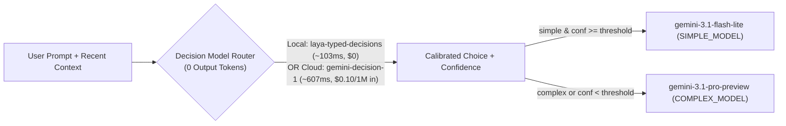

# Model Routing with Decision Models (`laya_adk_model_router` & `decisions_adk_model_router`)

Dynamic LLM model routing for [Google Agent Development Kit (ADK)](https://google.github.io/adk-docs/) powered by **non-autoregressive Decision Models**—generating **zero output tokens** to classify prompt complexity in a single forward pass and route `LlmRequest.model` between **`gemini-3.1-flash-lite`** (`SIMPLE_MODEL`) and **`gemini-3.1-pro-preview`** (`COMPLEX_MODEL`):

1. **[`laya_adk_model_router/`](laya_adk_model_router/)** — **Local System-1 Decision Model ([`convaiinnovations/laya`](https://huggingface.co/convaiinnovations/laya))**: Runs `laya-typed-decisions` (`421M` ModernBERT-large) locally in-process on CPU / Apple Silicon MPS / GPU (~60–130ms, `$0.00` routing cost, `0` output tokens).
2. **[`decisions_adk_model_router/`](decisions_adk_model_router/README.md)** — **Google Gemini Decisions API ([`gemini-decision-1`](https://ai.google.dev/gemini-api/docs/decisions-api))**: Calls Google's hosted `gemini-decision-1` (`v1beta`) model to evaluate typed `choice` / `noul` / `score` questions in a single forward pass with **0 output tokens** (`$0.10 / 1M` input tokens, 262K multimodal context window, and `0.95–1.00` calibrated probabilities).

---

## Directory Structure

```text
model_router/
├── .gitignore
├── README.md
├── requirements.txt
├── laya_adk_model_router/          # 1. Local System-1 Laya Decision Router (`convaiinnovations/laya`)
│   ├── __init__.py
│   ├── .env
│   ├── agent.py
│   ├── plugin.py
│   └── questions.py
├── decisions_adk_model_router/     # 2. Cloud Google Gemini Decisions API Router (`gemini-decision-1`)
│   ├── __init__.py
│   ├── .env
│   ├── .env.example
│   ├── README.md
│   ├── agent.py
│   ├── plugin.py
│   └── questions.py
└── eval/                           # 5-Arm Multi-Agent ADK Benchmark Suite (`adk-finops`)
    ├── README.md
    ├── EVAL_REPORT.md
    ├── requirements-eval.txt
    ├── dataset_loader.py
    ├── multi_agent.py
    ├── run_eval.py
    └── data_cache/
        └── benchmark_samples_v2.json
```

---

## How Decision-Model Routing Works



1. **Intercept (`before_model_callback`)**: When a new user message arrives, [`LayaModelRouterPlugin`](laya_adk_model_router/plugin.py) or [`DecisionsModelRouterPlugin`](decisions_adk_model_router/plugin.py) extracts `user_message` and up to 4 turns of `recent_context`.
2. **Role-Aware Agent Exclusions (`exclude_agents`)**: In multi-agent hierarchies, lightweight orchestrator/triage agents (e.g., `coordinator_agent`) can be listed in `exclude_agents={"coordinator_agent"}` so they remain pinned to `SIMPLE_MODEL` (`gemini-3.1-flash-lite`), while specialist sub-agents are dynamically routed per query.
3. **Single-Pass Decision Evaluation (Zero Output Tokens)**:
   - **Laya (`laya_adk_model_router`)**: Evaluates [`LAYA_COMPLEXITY_QUESTIONS`](laya_adk_model_router/questions.py) locally via `laya.Router` and stores telemetry in `callback_context.state["laya_routing"]`.
   - **Gemini Decision 1 (`decisions_adk_model_router`)**: Evaluates [`DECISIONS_COMPLEXITY_QUESTIONS`](decisions_adk_model_router/questions.py) via Google's [Decisions API (`gemini-decision-1`, `v1beta`)](https://ai.google.dev/gemini-api/docs/decisions-api) and stores telemetry (`choice`, `confidence`, `probabilities`, `input_tokens`, `output_tokens=0`, `decision_cost_usd`, `decisions_latency_ms`) in `callback_context.state["decisions_routing"]`.
4. **Dynamic Model Swap**:
   - **`simple`** (with `confidence >= confidence_threshold`) $\rightarrow$ routes to **`gemini-3.1-flash-lite`** (`SIMPLE_MODEL`).
   - **`complex`** (or low confidence `< confidence_threshold`) $\rightarrow$ upgrades to **`gemini-3.1-pro-preview`** (`COMPLEX_MODEL`).
5. **Turn Persistence (`invocation_id`)**: The selected model is saved in `callback_context.state["routed_model"]` keyed by `invocation_id` so intermediate tool-response or sub-agent delegation steps within the same turn reuse the classification without redundant router calls.

> **Disclaimer — Customize [`questions.py`](laya_adk_model_router/questions.py) for Your Use Case:**
> Both Laya and Gemini Decision 1 condition directly on your question `instructions` and `criteria` descriptions at inference time. **You should update [`laya_adk_model_router/questions.py`](laya_adk_model_router/questions.py) or [`decisions_adk_model_router/questions.py`](decisions_adk_model_router/questions.py) (as well as `confidence_threshold`) to reflect the exact task boundaries, domain terminology, and escalation rules of your specific application.**

---

## Decision Models Compared: `Laya` vs. `Gemini Decision 1`

| Dimension | 1. Local Laya Router ([`laya_adk_model_router/`](laya_adk_model_router/)) | 2. Google Gemini Decisions API ([`decisions_adk_model_router/`](decisions_adk_model_router/README.md)) |
| :--- | :--- | :--- |
| **Decision Model(s)** | [`convaiinnovations/laya`](https://huggingface.co/convaiinnovations/laya) (`laya`, `laya-multilingual`, `laya-typed-decisions`) | **[`gemini-decision-1`](https://ai.google.dev/gemini-api/docs/decisions-api)** (`POST /v1beta/decisions` / `client.decisions.create`) |
| **Execution Environment** | Local in-process (CPU / Apple Silicon MPS / GPU) | Cloud Google Gemini Developer API (`v1beta`) |
| **Context Window & Modalities** | 512–1,024 tokens (text) | **262,144 tokens** (multimodal text, images, audio, video, PDF) |
| **Supported Question Types** | `choice`, `noul` (yes/no), `score` | `choice`, `noul` (yes/no), `score` (up to 1,000 questions/call) |
| **Output Tokens Generated** | **0** | **0** |
| **Router Inference Cost** | **$0.00** (local compute) | **$0.10 / 1M input tokens** (~`$0.00004` per turn) |
| **Avg Router Latency (`N=60`)** | **102.7 ms** (p95: `151.2 ms`) | **606.9 ms** (p95: `1,144.4 ms`) |
| **Avg Confidence (`N=60`)** | **0.71** (`0.56–0.83`) | **0.9801** (`0.9079–0.9991`) |

### Available Local Laya Checkpoints
If using [`laya_adk_model_router`](laya_adk_model_router/), the [`convaiinnovations/laya`](https://huggingface.co/convaiinnovations/laya) hub provides three checkpoints (preloading `laya-typed-decisions` by default):

| Checkpoint | Backbone Encoder | Params | Context | Best at |
| :--- | :--- | :--- | :--- | :--- |
| **[`convaiinnovations/laya`](https://huggingface.co/convaiinnovations/laya)** (`"english"`) | ModernBERT-large | 421M | 512 | English text, guardrails, email triage |
| **[`convaiinnovations/laya-multilingual`](https://huggingface.co/convaiinnovations/laya-multilingual)** (`"multilingual"`) | mmBERT-base | 322M | 1024 (up to 8k) | 100+ languages, ~2.2x faster |
| **[`convaiinnovations/laya-typed-decisions`](https://huggingface.co/convaiinnovations/laya-typed-decisions)** (`"laya-typed-decisions"`) | ModernBERT-large | 421M | 1024 | Typed-decisions workflows (default) |

---

## Prerequisites & Installation

From the `model_router/` directory:

```bash
uv venv
uv pip install -r requirements.txt
```

### Configuring `.env`
- **For `laya_adk_model_router/.env`**:
  ```env
  GOOGLE_GENAI_USE_VERTEXAI=TRUE
  GOOGLE_CLOUD_PROJECT=your-gcp-project-id
  GOOGLE_CLOUD_LOCATION=global

  SIMPLE_MODEL=gemini-3.1-flash-lite
  COMPLEX_MODEL=gemini-3.1-pro-preview
  ```
- **For `decisions_adk_model_router/.env`** (requires `GEMINI_API_KEY` from Google AI Studio for `gemini-decision-1` on `v1beta`; ADK agents can still use Vertex AI or Gemini Developer API):
  ```env
  GEMINI_API_KEY=your_gemini_api_key_here

  GOOGLE_GENAI_USE_VERTEXAI=TRUE
  GOOGLE_CLOUD_PROJECT=your-gcp-project-id
  GOOGLE_CLOUD_LOCATION=global

  DECISION_MODEL=gemini-decision-1
  SIMPLE_MODEL=gemini-3.1-flash-lite
  COMPLEX_MODEL=gemini-3.1-pro-preview
  ```

---

## Running the Agents

From the `model_router/` directory:

```bash
# Launch the ADK Dev UI (select either "laya_adk_model_router" or "decisions_adk_model_router")
adk web

# Or run Laya Router interactively in the terminal
adk run laya_adk_model_router

# Or run Gemini Decisions API Router interactively in the terminal
adk run decisions_adk_model_router
```

---

## Usage Patterns

### 1. Single-Agent ADK App Plugin (`LayaModelRouterPlugin` or `DecisionsModelRouterPlugin`)

```python
from google.adk.agents import Agent
from google.adk.apps import App

# Option A: Local Laya Decision Model Router
from laya_adk_model_router import LayaModelRouterPlugin

# Option B: Cloud Google Gemini Decisions API Router (`gemini-decision-1`)
from decisions_adk_model_router import DecisionsModelRouterPlugin

root_agent = Agent(
    name="root_agent",
    model="gemini-3.1-pro-preview",
    instruction="You are an AI assistant.",
)

app = App(
    name="routed_adk_app",
    root_agent=root_agent,
    # Swap between LayaModelRouterPlugin and DecisionsModelRouterPlugin with identical arguments:
    plugins=[DecisionsModelRouterPlugin(confidence_threshold=0.7)],
)
```

### 2. Multi-Agent Hierarchy with Role-Aware Exclusions (`exclude_agents`)

Keep lightweight orchestrator/triage agents pinned to `SIMPLE_MODEL` (`gemini-3.1-flash-lite`) while dynamically routing specialist sub-agents between `SIMPLE_MODEL` and `COMPLEX_MODEL`:

```python
from google.adk.agents import Agent
from google.adk.apps import App
from decisions_adk_model_router import COMPLEX_MODEL, SIMPLE_MODEL, DecisionsModelRouterPlugin
# Or: from laya_adk_model_router import COMPLEX_MODEL, SIMPLE_MODEL, LayaModelRouterPlugin

coordinator_agent = Agent(
    name="coordinator_agent",
    model=SIMPLE_MODEL,  # Always runs on gemini-3.1-flash-lite
    instruction="Route user requests to the right specialist sub-agent.",
    sub_agents=[fast_qa_agent, math_analyst_agent, code_engineer_agent],
)

app = App(
    name="multi_agent_router_app",
    root_agent=coordinator_agent,
    plugins=[
        DecisionsModelRouterPlugin(
            confidence_threshold=0.55,
            exclude_agents={"coordinator_agent"},
        )
    ],
)
```

### 3. Standalone `before_model_callback` (`laya_router` or `decisions_router`)

```python
from google.adk.agents import Agent
from decisions_adk_model_router import decisions_router
# Or: from laya_adk_model_router import laya_router

root_agent = Agent(
    name="root_agent",
    model="gemini-3.1-pro-preview",
    instruction="You are an AI assistant.",
    before_model_callback=decisions_router,
)
```

---

## Multi-Agent Benchmark Evaluation (`eval/`)

The [`eval/`](eval/README.md) directory contains a reproducible **5-arm evaluation suite** comparing a 4-Agent ADK hierarchy (`coordinator_agent` $\rightarrow$ `fast_qa_agent`, `math_analyst_agent`, `code_engineer_agent`) with `temperature=0.0` pinned across all agents on **60 real open-source Hugging Face benchmark tasks per arm** (**300 multi-agent turns**) structured as a **2x3 Domain $\times$ Complexity Matrix** (`10 Simple + 10 Complex` per specialist agent), instrumented with **[`adk-finops`](https://pypi.org/project/adk-finops/)**:

- **`fast_qa_agent` (20 QA tasks)**: `10 ARC-Easy` (`simple`) + `10 MMLU-Pro` (`complex`)
- **`math_analyst_agent` (20 Math tasks)**: `10 GSM8K` (`simple`) + `10 MATH-500 Level 5` (`complex`)
- **`code_engineer_agent` (20 Coding tasks)**: `10 MBPP` (`simple`) + `10 HumanEval` (`complex`)

| Metric | 1. All-Simple (`gemini-3.1-flash-lite`) | 2. All-Complex (`gemini-3.1-pro-preview`) | 3. Static Hybrid (`Coord=Simple, Subs=Complex`) | 4. With Laya Router (`laya-typed-decisions`) | 5. With Decisions API (`gemini-decision-1`) | Laya vs. All-Complex | Decisions vs. All-Complex | Decisions vs. Laya |
| :--- | ---: | ---: | ---: | ---: | ---: | ---: | ---: | ---: |
| **Operational Success Rate** | 100.0% (60/60) | 100.0% (60/60) | 100.0% (60/60) | **100.0% (60/60)** | **100.0% (60/60)** | +0.0% | +0.0% | +0.0% |
| **Ground-Truth Accuracy (%)** | 86.7% (52/60) | 100.0% (60/60) | 100.0% (60/60) | **100.0% (60/60)** | **100.0% (60/60)** | **+0.0% (+13.3% vs Simple)** | **+0.0% (+13.3% vs Simple)** | **0.0%** |
| **Router Tier Classification** | — | — | — | **100.0% (60/60)** | **100.0% (60/60)** | — | — | **0.0%** |
| **Avg Router Confidence** | — | — | — | **0.71** (0.56–0.83) | **0.9801** (0.9079–0.9991) | — | — | **+0.27** |
| **Total Cost (USD)** | $0.053324 | $1.543620 | $1.260022 | **$1.119405** | **$1.069982** | **-27.5% ($0.424 saved)** | **-30.7% ($0.474 saved)** | **-4.4%** |
| **Simple-Tier Tasks Cost (`N=30`)** | $0.016474 | $0.313328 | $0.250687 | **$0.016566** | **$0.017419** | **-94.7%** | **-94.4%** | +5.2% |
| **Router Inference Cost (`N=60`)** | $0.000000 | $0.000000 | $0.000000 | **$0.000000** (local) | **$0.002394** (23,941 tok) | $0.00 | +$0.002394 | +$0.002394 |
| **Thinking Tokens (`thoughts_tokens`)** | 0 | 92,742 | 77,628 | **69,963** | **66,050** | **-24.6%** | **-28.8%** | -5.6% |
| **Avg Turn Latency (ms)** | 4,696.1 ms | 26,118.9 ms | 22,831.1 ms | **17,747.2 ms** | **17,742.1 ms** | **-32.1% (-8.4s)** | **-32.1% (-8.4s)** | **-0.0%** |
| **Avg Router Overhead (ms)** | 0.0 ms | 0.0 ms | 0.0 ms | **102.7 ms** (p95: 151ms) | **606.9 ms** (p95: 1144ms) | +102.7 ms | +606.9 ms | **+490.9%** |

> [!NOTE]
> **Illustrative Benchmark Disclaimer & Exploring Alternatives:**
> The multi-agent benchmark shown above is a **simple, illustrative test use case** designed to validate routing mechanics and telemetry—it is **not conclusive across all production workloads or domain distributions**. Because routing effectiveness depends heavily on your prompt distribution, latency SLOs, and task boundaries, we strongly encourage you to:
> 1. **Evaluate `laya_adk_model_router` and `decisions_adk_model_router` on your own use cases and production traffic**, customizing [`LAYA_COMPLEXITY_QUESTIONS`](laya_adk_model_router/questions.py) / [`DECISIONS_COMPLEXITY_QUESTIONS`](decisions_adk_model_router/questions.py) and `confidence_threshold` for your domain.
> 2. **Explore and benchmark other routing alternatives**—such as **`jev`** and other lightweight classifiers or semantic/embedding routers—alongside Laya and Gemini Decision 1 to compare accuracy, latency overhead, and cost savings on your specific workload.

- **Full Evaluation Report**: [`eval/EVAL_REPORT.md`](eval/EVAL_REPORT.md)
- **Evaluation Suite Instructions**: [`eval/README.md`](eval/README.md)
- **Gemini Decisions API Router Guide**: [`decisions_adk_model_router/README.md`](decisions_adk_model_router/README.md)

```bash
# Install evaluation dependencies and run the 60-sample 5-arm benchmark (uses local cache in eval/data_cache/)
uv pip install -r eval/requirements-eval.txt
python -m eval.run_eval --samples-per-dataset 10 --concurrency 5

# Or run a single arm standalone (e.g., with_decisions_router)
python -m eval.run_eval --samples-per-dataset 10 --concurrency 5 --modes with_decisions_router
```
